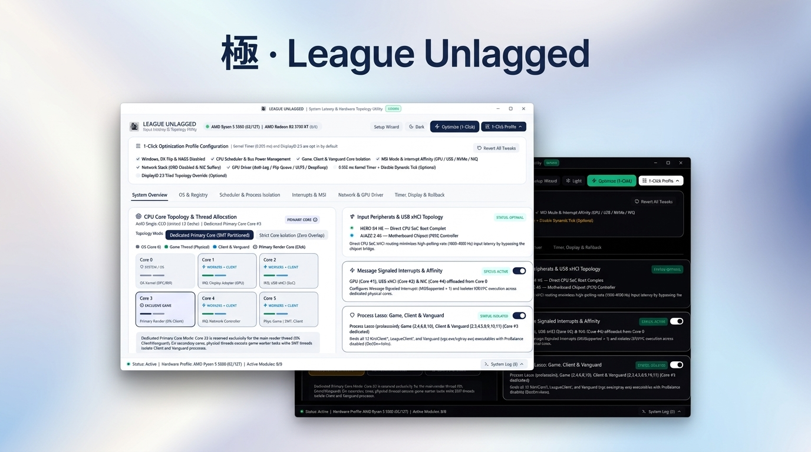
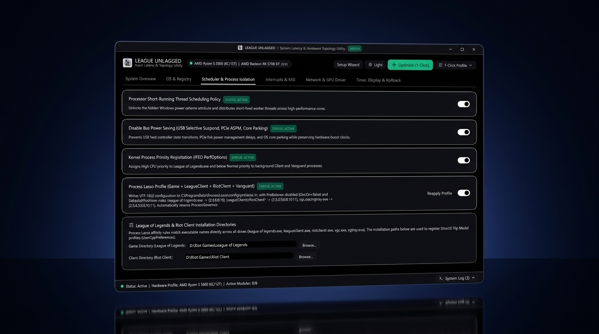
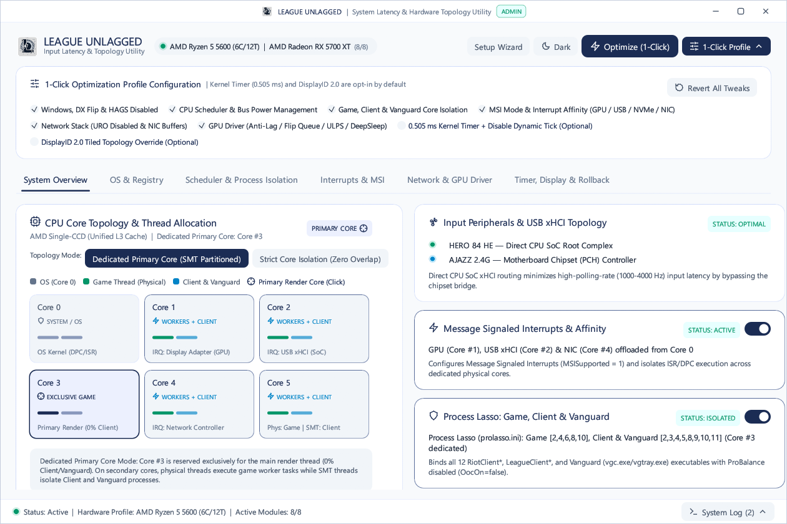
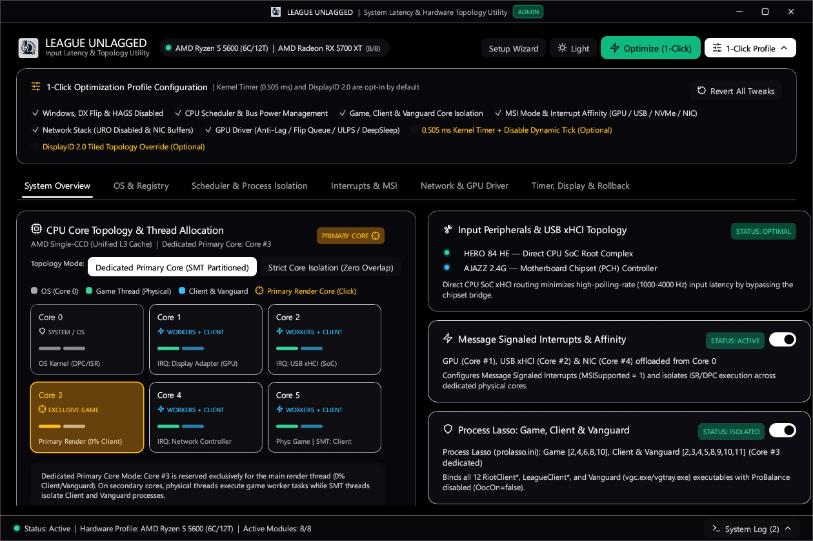

<div align="center">

  

  <br />
  <br />

  <h1>極 · League Unlagged</h1>
  <p>
    <strong>Hardware-Adaptive Topology</strong> &nbsp;│&nbsp;
    <strong>Sub-Millisecond Input Pipeline</strong> &nbsp;│&nbsp;
    <strong>Zero-Telemetry Native Rust</strong>
  </p>

  <p>
    <em>The definitive hardware-adaptive input latency, CPU core isolation, and PCIe interrupt optimizer for League of Legends.</em><br />
    <small>Engineered in pure native Rust with Win32 kernel topology introspection, dual-mode SMT thread partitioning, and instant 1-click rollback.</small>
  </p>

  <p>
    <a href="https://github.com/prfctcondition/league-unlagged/releases/latest"></a>
    
    
    
    
    <a href="LICENSE"></a>
  </p>

  <br />

  <p>
    <a href="https://github.com/prfctcondition/league-unlagged/releases/latest">
      
    </a>
  </p>

  <br />
</div>

---

## ✦ Why League Unlagged?

> *Mainstream "gaming boosters" and blind batch scripts treat every computer identically—applying hardcoded core masks, unsafe registry edits, and background bloatware that actively degrade 1% low frame times.*

**League Unlagged was engineered from the ground up as a deterministic, hardware-aware systems utility.**

League of Legends relies on a heavily serialized DirectX 11 simulation and render architecture that is extraordinarily sensitive to **L3 cache thrashing**, **SMT sibling contention**, and **Core 0 DPC/ISR interrupt storms**. Every time Chromium-based `LeagueClientUxRender.exe` worker processes, Riot Vanguard (`vgc.exe`), or unpinned network/USB interrupts preempt the game's primary render thread, players experience micro-stutter and inconsistent mouse polling during high-APM combat.

Instead of guessing your hardware, **League Unlagged queries the Windows kernel directly**—mapping your physical CPU cores, SMT/Hyper-Threading pairs, L3 cache domains (`RelationCache`), Intel P/E efficiency classes, PCIe bus interrupt lines, and USB xHCI root complexes in real time to synthesize a mathematically optimal isolation profile for your exact machine.

---

## ✧ Features & Architecture

### ▸ 01. Universal Win32 Silicon & Cache Topology Profiler
- **Real-Time Kernel Introspection**: Queries `GetLogicalProcessorInformationEx` to map physical processor cores, logical SMT/HT siblings, Intel Hybrid `EfficiencyClass` (P-Cores vs E-Cores), and AMD L3 cache complexes (`RelationCache`).
- **Cross-Architecture Adaptation**: Automatically adapts bitmasks across **4C/8T**, **6C/6T**, **6C/12T**, **8C/16T (X3D)**, **12C/24T & 16C/32T Dual-CCD**, and **Intel 12th–14th Gen / Core Ultra Hybrid** processors.
- **Interactive Topology Simulator**: Preview how the scheduler engine partitions threads across 11 hardware presets directly inside the GUI without modifying your live configuration.

### ▸ 02. Dual-Mode Core Isolation & Riot Vanguard Containment
- **Dedicated Primary Core Mode (`SMT Partitioned`)**: Reserves a selectable high-clock physical core (default `Core #3`, `0%` background load) exclusively for the primary game thread while partitioning remaining physical threads for game workers and SMT logical threads for background services.
- **Strict Core Isolation Mode (`Zero Overlap`)**: Dedicates physical cores exclusively to `League of Legends.exe` and locks all `LeagueClient*`, `RiotClient*`, and Riot Vanguard (`vgc.exe`, `vgtray.exe`) processes onto a single isolated auxiliary core (`Core #1`).
- **Automated Process Lasso Engine (`prolasso.ini`)**: Generates and injects UTF-16LE `DefaultAffinitiesEx` rules across all 12 Riot/League/Vanguard executables, enforces `OocOn=false` (disabling ProBalance mid-fight core shifting), and restarts `ProcessGovernor` seamlessly.
- **Native Rust Real-Time Governor (`SeDebugPrivilege`)**: Built-in low-overhead background thread that enforces `SetProcessAffinityMask` and priority classes natively even on systems without Process Lasso installed.

### ▸ 03. Hardware-Verified MSI Mode & Interrupt Affinity Offloading
- **Dynamic PCI Bus Enumeration**: Scans `HKLM\SYSTEM\CurrentControlSet\Enum\PCI` across **Discrete GPUs**, **USB 3.0 xHCI Host Controllers**, **NVMe Storage Controllers**, and **Network Adapters**.
- **Hardware Capability Verification**: Inspects `Interrupt Management\MessageSignaledInterruptProperties` before writing `MSISupported = 1` and configures device-appropriate `MessageNumberLimit` bounds.
- **Strict Hardware Safety Blacklist**: Automatically excludes legacy High Definition Audio controllers, AHCI/IDE SATA bridges, SMBus, and platform timers to guarantee zero BSOD risk.
- **Core 0 DPC/ISR Offloading (`AssignmentSetOverride`)**: Pins GPU interrupts to `Core #1`, USB xHCI interrupts to `Core #2`, and Network/NVMe interrupts to `Core #4` using validated `REG_BINARY` bitmasks.

### ▸ 04. USB xHCI Root Complex & Peripheral Bus Tracer
- **PnP Parent Chain Traversal**: Walks the `DEVPKEY_Device_Parent` tree from active HID mice and keyboards up to their physical PCI USB xHCI host controller.
- **SoC vs. PCH Fabric Detection**: Identifies whether your mouse and keyboard are routed directly through **CPU SoC PCIe lanes** (lowest input latency for `1000–8000 Hz` polling rates) or through the **Motherboard Chipset (PCH)** bridge.

### ▸ 05. GPU Driver Pre-Render Queue & Radeon Anti-Lag Engine
- **Dynamic Driver Class Discovery**: Scans `HKLM\SYSTEM\CurrentControlSet\Control\Class\{4d36e968-e325-11ce-bfc1-08002be10318}\0000..000X` with strict Vendor ID validation (`VEN_1002` AMD / `VEN_10DE` NVIDIA).
- **AMD Radeon Anti-Lag & FlipQueueSize**: Enables driver-level `AntiLag_Dev = 1`, sets `FlipQueueSize = 0x3100` (1 pre-rendered frame), and disables `EnableUlps` plus shader/DMA DeepSleep power states (`EnableGfxClockGating`, `EnableSclkDeepSleep`, `EnableDmaDeepSleep`).
- **NVIDIA Low-Latency Profile Generator (`.nip`)**: Exports ready-to-import `NVIDIA Profile Inspector` XML profiles configured for Ultra Low Latency (`UltraLowLatency = 1`, `PreferredRefreshRate = Highest`, `PowerManagement = Prefer Maximum Performance`).

### ▸ 06. DirectX Flip Model, Windowed G-Sync & MMCSS Tuning
- **DirectX 11 Independent Flip Upgrade**: Registers `SwapEffectUpgradeEnable=1` inside `DirectX\UserGpuPreferences` for your exact `League of Legends.exe` path so Borderless Windowed mode bypasses DWM composition latency.
- **HAGS & GameDVR Elimination**: Disables Hardware-Accelerated GPU Scheduling (`HwSchMode = 1`) and background GameBar/DVR hooks to prevent micro-stutter on DX11 titles.
- **MMCSS & Win32 Priority Separation**: Sets `Win32PrioritySeparation = 0x26` (short, fixed foreground quantums) and lowers Multimedia Class Scheduler `SystemResponsiveness` to `10%`.

### ▸ 07. 0.505 ms Kernel Timer & DisplayID 2.0 Topology Engine
- **Sub-Millisecond System Timer (`0.505 ms`)**: Locks the Windows kernel clock interval to `5050` (`100 ns` units) via `ntdll!NtSetTimerResolution` alongside `bcdedit /set disabledynamictick yes`.
- **Universal DisplayID 2.0 Tiled Topology Override**: Synthesizes a standards-compliant 128-byte **DisplayID 2.0 (`0x70`) + Tiled Display Topology (`0x22`)** extension block for Custom Resolution Utility (`CRU`), dynamically reading your active monitor resolution (`1680×1050`, `1920×1080`, `2560×1440`, `3840×2160`) to unlock maximum native refresh rates and cleaner scaler signal paths.

### ▸ 08. First-Launch Setup Wizard & 1-Click Rollback
- **Interactive Onboarding Wizard**: Guides you through creating a Windows System Restore Point (`WMI SystemRestore`) and verifying your `League of Legends` and `Riot Client` installation directories on first launch.
- **Granular 1-by-1 Toggles & Baseline Snapshot**: Every optimization module features an independent real-time toggle switch backed by an automatic initial state snapshot (`backup_original_state.json`) for instant 1-click restoration.

---

<div align="center">
  
  <p><em>Granular Scheduler, IFEO Kernel Priority, and automated Process Lasso profile generation for Game, Client, and Riot Vanguard.</em></p>
</div>

---

## 🕮 Dual Theme System (Light & OLED Dark)

| Royal Navy Light Theme (`#1B2C54` Default) | Monochromatic OLED Dark Theme (`#000000`) |
| :---: | :---: |
|  |  |

---

## 🕮 Optimizer & Architecture Comparison

| Capability | League Unlagged | Generic `.bat` / `.reg` Scripts | Commercial "Game Boosters" | Manual Process Lasso + Regedit |
| :--- | :---: | :---: | :---: | :---: |
| **Price & Licensing** | **100% Free & Open-Source** | Free | $5–$15/mo Subscription | Paid Pro License + Manual Setup |
| **Background Bloat & Telemetry** | **❌ Zero *(Native Rust)*** | ❌ None | ⚠️ Heavy Electron / Adware Daemons | ⚠️ Manual Configuration |
| **CPU Topology Detection** | **✔️ Live Win32 Kernel Query** | ❌ Hardcoded Bitmasks | ⚠️ Basic Core Count Only | ❌ Manual Bitmask Math |
| **Dedicated Primary Render Core** | **✔️ 1-Click Interactive Core Pin** | ❌ No | ❌ No | ⚠️ Requires Manual Hex Masks |
| **Riot Vanguard (`vgc.exe`) Isolation** | **✔️ Automated (`prolasso.ini` + Native)** | ❌ Blocked by Vanguard | ❌ Ignored | ⚠️ Must Add 12 Executables Manually |
| **Hardware-Verified MSI Mode** | **✔️ Safe PCI Scan + Blacklist** | ⚠️ Blind Writes *(BSOD Risk)* | ❌ Rarely Supported | ⚠️ External `MSI_util_v3` Required |
| **USB xHCI SoC vs. PCH Tracer** | **✔️ Full PnP Parent Chain Trace** | ❌ No | ❌ No | ❌ Requires Device Manager Digging |
| **AMD Anti-Lag & FlipQueueSize** | **✔️ Dynamic `000X` Subkey Discovery** | ⚠️ Hardcoded `0000` *(Breaks on DDU)* | ⚠️ Partial | ⚠️ Manual Registry Hunting |
| **1-Click State Rollback** | **✔️ JSON Snapshot + Restore Point** | ❌ Irreversible | ⚠️ Partial | ❌ Manual Revert |

---

## ⚙ Supported Processor Topologies

| Architecture Class | Example Processors | Primary Render Core | Game Worker Threads | Client & Vanguard Isolation |
| :--- | :--- | :---: | :---: | :---: |
| **4C / 8T SMT** | Intel Core i3-12100F, Ryzen 3 3300X | `Core #3` *(Exclusive)* | Physical Cores `1, 2, 3` | SMT Siblings on Cores `1, 2` |
| **6C / 6T Non-SMT** | Intel Core i5-9400F, Core i5-8400 | `Core #3` *(Exclusive)* | Physical Cores `2, 3, 4, 5` | Isolated on `Core #1` |
| **6C / 12T SMT** | AMD Ryzen 5 5600 / 7600, Core i5-12400F | `Core #3` *(Exclusive)* | Physical Threads `[2,4,6,8,10]` | SMT Threads `[2,3,4,5,8,9,10,11]` |
| **8C / 16T Single-CCD / X3D** | Ryzen 7 5800X3D, 7800X3D, 9800X3D | `Core #3` *(Exclusive)* | Physical Threads `[2,4,6,8,10,12,14]` | SMT Threads *(Core #3 Excluded)* |
| **12C / 16C Dual-CCD (X3D)** | Ryzen 9 5900X, 7900X3D, 7950X3D | `CCD0 Core #3` | Locked to `CCD0` *(3D V-Cache)* | Offloaded to `CCD1` *(Zero Cross-CCX)* |
| **Intel Hybrid (P + E Cores)** | Core i5-13600K, i7-14700K, i9-14900K | `P-Core #3` *(Exclusive)* | Physical `P-Cores` Only | Offloaded Exclusively to `E-Cores` |

---

## ⚙ Installation

### Windows Installer (Recommended)
1. Download the latest installer from the [Releases page](https://github.com/prfctcondition/league-unlagged/releases/latest):
   - **`League-Unlagged-Windows-installer.exe`** *(Official Setup Wizard — automatically creates a Desktop & Start Menu shortcut pre-configured to **Run as Administrator**)*
   - **`league-unlagged.exe`** *(Standalone Portable Binary)*
2. Run **`League-Unlagged-Windows-installer.exe`**, click **Install**, and launch **League Unlagged** directly from your Desktop shortcut.
3. Complete the 2-step **Setup Wizard** on first launch to create a Windows System Restore Point and verify your `League of Legends` directory.

---

## ⚙ Building From Source

### Prerequisites
- [Rust Toolchain](https://rustup.rs/) *(1.80+ stable, `x86_64-pc-windows-msvc`)*
- Windows 10 or Windows 11 SDK

### Setup & Compile
```powershell
# 1. Clone the repository
git clone https://github.com/prfctcondition/league-unlagged.git
cd league-unlagged

# 2. Run the automated hardware & topology unit test suite
cargo test

# 3. Build optimized production release binary
cargo build --release

# 4. Launch with Administrator privileges
.\Run-LeagueUnlagged-Admin.bat
```

### CLI Diagnostic Mode
```powershell
# Print a complete Win32 CPU cache, USB xHCI parent chain, and registry state report
.\target\release\league-unlagged.exe --cli-report
```

---

## ⏱ Roadmap

- ✔ **Universal Win32 Topology Engine**: Automatic detection of physical cores, SMT siblings, Intel Hybrid E-cores, and AMD L3 cache domains.
- ✔ **Dual-Mode Core Isolation**: Instant switching between *Dedicated Primary Core (SMT Partitioned)* and *Strict Core Isolation (Zero Overlap)*.
- ✔ **Interactive Primary Core Selector**: Click any CPU core tile on the dashboard to rebind the primary render thread in real time.
- ✔ **Hardware-Verified MSI & IRQ Pinning**: Safe PCI enumeration with hardware capability checks and `Core 0` interrupt offloading.
- ✔ **Dynamic AMD Radeon Anti-Lag & NVIDIA `.nip` Profiles**: Automatic `000X` display driver subkey discovery and pre-render queue minimization.
- ✔ **DisplayID 2.0 Tiled Topology Generator**: Resolution-adaptive 128-byte extension block builder for Custom Resolution Utility (`CRU`).
- ✔ **Asynchronous Non-Blocking Worker Engine**: Smooth animated progress overlay for WMI, PowerShell, and registry transactions.
- ⏱ **Per-Champion Polling & Frame-Time Telemetry Overlay**: Optional lightweight ETW (`PresentMon`) frame-pacing analyzer after matches.

---

## ☆ Support

League Unlagged is 100% free, open-source, and built without subscriptions, advertisements, or background telemetry.

If League Unlagged eliminated your frame drops, sharpened your mouse response, or helped you climb with cleaner mechanics, support for the craft is received with quiet gratitude:

<p align="center">
  <a href="https://ko-fi.com/prfctcondition">
    
  </a>
  <br />
  <sub><a href="https://ko-fi.com/prfctcondition">ko-fi.com/prfctcondition</a></sub>
</p>

---

## ✦ Engineering & Philosophy

League Unlagged is engineered as a zero-bloat, deterministic systems utility written in native Rust (`eframe`/`egui` + `windows-sys`). Every registry mutation, PCI interrupt policy, and scheduler affinity bitmask is validated against live hardware capabilities before execution and backed by an atomic JSON state snapshot for complete reversibility.

> *「 Precision in silicon, clarity in motion. 」*

## 🕮 License

Distributed under the [MIT License](LICENSE). Crafted by **prfctCondition**.
